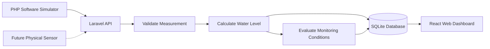

# 💧 AquaSense

**Affordable, open-source water tank monitoring with ESP32, a web dashboard, and a lightweight backend.**

AquaSense is a water-monitoring project designed to help users understand how much water remains in a storage tank, track changes over time, and identify potentially abnormal water-level changes.

The project combines an IoT-oriented backend, a browser-based dashboard, and a software simulator. The software can currently be run locally without physical sensor hardware.

> **Development status:** AquaSense is a working software prototype, not yet a validated hardware product. Current readings come from simulation. Physical sensor accuracy, device-to-server Wi-Fi communication, and production deployment still require validation.

## Overview

Water storage can be difficult to monitor when measurements are taken manually or when changes go unnoticed between inspections. AquaSense explores a low-cost way to make water-level information easier to access and understand.

The system is designed to:

- Monitor water levels and estimated remaining capacity.
- Visualize measurements and changes over time.
- Identify low-water conditions and unusual level changes.
- Track whether measurements are recent or a device appears offline.
- Provide a foundation for future ESP32-based monitoring hardware.

The long-term goal is to make water monitoring more accessible for household tanks and other suitable storage installations.

## Current capabilities

The current local prototype includes the following components and functionality.

| Component | Current implementation |
|---|---|
| Backend API | Laravel and PHP |
| Database | SQLite for local development |
| Web dashboard | React, TypeScript, Vite and Tailwind CSS |
| Water-level calculations | Distance-to-height, percentage and estimated volume |
| Tank geometry | Vertical cylindrical and rectangular tanks |
| Monitoring | Measurement history and dashboard visualizations |
| Alert logic | Low water, unusual drops, refill-related changes, overflow risk and sensor/status conditions |
| Software simulation | PHP simulator with eight scenarios |
| Virtual hardware | ESP32-S3 and HC-SR04 in Wokwi |

These capabilities describe the current prototype. They do not imply that the physical hardware or every future feature has been validated in real-world conditions.

## How it works

AquaSense separates measurement acquisition from water-level calculations. The software simulator supplies distance measurements, while the backend converts these measurements into useful tank information.



### Measurement processing

1. A simulator or, in a future validated implementation, a physical device provides a distance measurement in centimetres.
2. The backend validates and processes the measurement.
3. Tank geometry and sensor positioning are used to estimate water height, percentage of capacity and volume.
4. The application stores readings and evaluates monitoring conditions.
5. The dashboard displays available measurements, history and status information.

The actual water level and volume depend on correct tank dimensions, sensor installation and calibration. Calculated volumes are estimates, not direct measurements of litres.

## Technology stack

**Backend**
- PHP 8.3+
- Laravel
- SQLite
- PHPUnit testing

**Frontend**
- React
- TypeScript
- Vite
- Tailwind CSS

**IoT and simulation**
- ESP32-S3 development platform
- Wokwi virtual hardware simulation
- PHP-based software telemetry simulator

**Development tools**
- Git
- Composer
- Node.js and npm

## Run locally on Windows

The following instructions use **Windows PowerShell**. They are intended for local development and demonstration, not production deployment.

### Prerequisites

Install the following software:

- [Git for Windows](https://git-scm.com/download/win)
- [PHP 8.3 or newer](https://windows.php.net/download/)
- [Composer](https://getcomposer.org/download/)
- [Node.js](https://nodejs.org/)

Ensure PHP is available in PowerShell and that the required extensions are enabled, including SQLite/PDO SQLite and the standard Laravel dependencies.

Verify the installations:

```powershell
git --version
php -v
composer --version
node --version
npm --version
```

### 1. Clone the repository

```powershell
git clone https://github.com/RMXHM/aquasense-iot.git
Set-Location aquasense-iot
```

### 2. Start the backend

Open a PowerShell terminal at the repository root:

```powershell
Set-Location backend

composer install

if (-not (Test-Path .env)) {
    Copy-Item .env.example .env
}

if (-not (Test-Path database/database.sqlite)) {
    New-Item -ItemType File database/database.sqlite | Out-Null
}

php artisan key:generate
php artisan migrate:fresh --seeder=AquaSenseDemoSeeder
php artisan serve --host=127.0.0.1 --port=8000
```

Leave this terminal running.

The commands above initialize a local environment, create or prepare the SQLite database, and load demo data. The database reset command deletes existing tables, so use it only with a disposable development database.

### 3. Start the dashboard

Open a second PowerShell terminal at the repository root:

```powershell
Set-Location frontend

npm install
npm run dev
```

Open the local URL printed by Vite, normally:

**http://localhost:5173**

The dashboard uses the local backend during development. Keep the backend and frontend running while testing the application.

### 4. Generate simulated measurements

Open a third PowerShell terminal at the repository root:

```powershell
php .\simulation\software\simulate.php --list
```

The simulator currently supports these scenarios:

- `normal`
- `consumption`
- `refill`
- `low_water`
- `sudden_drop`
- `overflow_risk`
- `sensor_error`
- `offline`

For example, to simulate water consumption and send readings every five seconds:

```powershell
php .\simulation\software\simulate.php --tank=1 --scenario=consumption --interval=5
```

Keep the simulator running to generate new telemetry. Its output reports measurement submission results. Successful submission to the local API confirms the software path is working; it does not demonstrate that a physical sensor or ESP32 has transmitted the same data.

## Testing and building

Run the backend tests from the `backend` directory:

```powershell
php artisan test
```

Check and build the frontend from the `frontend` directory:

```powershell
npm run typecheck
npm run build
```

These commands help verify the application code and frontend build. They do not replace real-hardware testing, security testing or deployment checks.

## Project structure

```text
aquasense-iot/
├── backend/                 # Laravel API, domain logic and tests
├── frontend/                # React dashboard
├── simulation/
│   ├── software/            # PHP telemetry simulator
│   └── wokwi/               # Virtual ESP32-S3 circuit and firmware
├── firmware/
│   └── reference/           # Retained firmware reference material
├── docs/                    # Technical documentation
├── THIRD_PARTY_LICENSES/    # Third-party license notices
├── .gitignore
├── LICENSE
└── README.md
```

## Current limitations

AquaSense is still under development. The following limitations are important:

- **Simulated measurements:** The current dashboard data is not proof of real-world water levels.
- **Hardware validation:** No physical sensor has been validated for measurement accuracy, installation conditions or waterproofing.
- **Sensor selection:** The HC-SR04 is currently a virtual demonstration component. The final physical sensor has not been selected and validated.
- **Device connectivity:** Real ESP32-S3-to-server telemetry over Wi-Fi has not yet been demonstrated end to end.
- **Security:** Production-ready user authentication, device ownership, secure activation, telemetry protection and rate limiting remain unfinished.
- **Deployment:** Remote monitoring requires a properly deployed and secured backend; the local development setup is not a hosted service.
- **Safety:** The prototype must not be used as the sole protection against tank overflow, pump damage or other hazards.

Do not expose the development server publicly or use demonstration credentials in a real installation.

## Roadmap

The next stages of development are:

1. Select an appropriate physical water-level sensor based on cost, range, environmental conditions and reliability.
2. Validate the sensor with the target ESP32-S3 hardware and compare its readings with manual measurements.
3. Verify reliable device-to-server communication over Wi-Fi.
4. Improve device provisioning, authentication and telemetry security.
5. Validate alerts and measurement recovery under realistic operating conditions.
6. Prepare a documented deployment setup for remote monitoring.
7. Explore additional capabilities such as flow monitoring, leak detection and optional pump control with independent safety mechanisms.

## Documentation

Technical details and implementation notes are maintained in the [`docs/`](docs/) directory.

Start with the relevant document for architecture, API behaviour, simulation, calibration, hardware decisions or project provenance. Documentation should be treated as implementation-specific: features described as planned are not necessarily available in the current version.

## Project origin and licensing

AquaSense originated from a fork and adaptation of [hladinomer-studna-scripty (Watmonitor)](https://github.com/martinius96/hladinomer-studna-scripty) by Martin Chlebovec.

The project has since been developed around AquaSense's own monitoring workflow, backend, dashboard and simulation. Original license and copyright notices for retained upstream material are preserved. Third-party components and their applicable licenses are identified in [`THIRD_PARTY_LICENSES/`](THIRD_PARTY_LICENSES/) and the relevant reference files.

See [`LICENSE`](LICENSE) and the documentation for the applicable terms and provenance details.

---

**AquaSense — making water-level monitoring more accessible through open-source software and affordable IoT hardware.**
