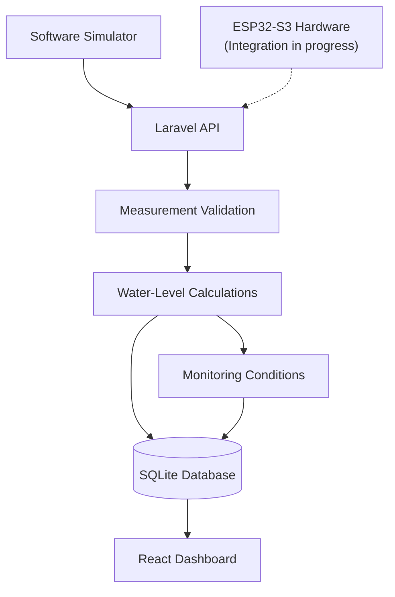

# AquaSense

**Smart Water Monitoring | ESP32-S3 · Laravel · React · TypeScript**

AquaSense is an open-source water-monitoring platform designed to make tank-level information easier to measure, visualize, and understand. It combines a web dashboard, a backend API, and a telemetry simulator, with the goal of supporting affordable water monitoring through IoT hardware.

The platform is being developed to help users monitor water availability, track level changes, and identify potentially abnormal conditions through a centralized interface.

> **Project status:** Software prototype. The backend, dashboard, and software simulation are available for local development. Physical sensor accuracy, real-device connectivity, and production deployment have not yet been validated.

## Features

- **Water-level monitoring:** Calculate estimated water height, remaining capacity, and volume from distance measurements.
- **Tank visualization:** View tank information and historical measurements through a web dashboard.
- **Monitoring conditions:** Evaluate low-water conditions, sudden level changes, and potential overflow risks.
- **Measurement history:** Store readings for inspection and visualization.
- **Device status:** Represent recent telemetry, missing readings, and sensor error conditions.
- **Software simulation:** Generate test measurements without requiring physical sensor hardware.
- **IoT-ready architecture:** Develop and validate the software independently while preparing for ESP32-S3 integration.

Features that depend on physical hardware remain subject to further testing.

## Architecture

AquaSense separates data collection, measurement processing, persistence, and presentation.



### Data flow

1. The simulator generates distance measurements in centimetres.
2. The backend receives and validates the incoming telemetry.
3. Tank geometry and sensor position are used to calculate estimated water height, percentage, and volume.
4. Measurements are stored and monitoring conditions are evaluated.
5. The dashboard presents available readings, history, and status information.

Calculated volume depends on accurate tank dimensions and sensor placement. It is an estimate derived from the measured distance, not a direct measurement of water volume.

## Technology stack

| Layer | Technologies |
|---|---|
| Backend | PHP, Laravel |
| Database | SQLite for local development |
| Frontend | React, TypeScript, Vite |
| Styling | Tailwind CSS |
| IoT platform | ESP32-S3 |
| Hardware simulation | Wokwi |
| Software simulation | PHP |
| Testing | PHPUnit, TypeScript compiler |
| Build tools | Composer, Node.js, npm |

## Project structure

```text
aquasense-iot/
├── backend/                 # API, application logic and tests
├── frontend/                # Web dashboard
├── firmware/
│   └── reference/            # Firmware reference material
├── simulation/
│   ├── software/             # Telemetry simulator
│   └── wokwi/                # Virtual hardware simulation
├── docs/                     # Technical documentation
├── THIRD_PARTY_LICENSES/     # Third-party license notices
├── .gitignore
├── LICENSE
└── README.md
```

## Getting started on Windows

These instructions use **Windows PowerShell** and are intended for local development.

### Prerequisites

Install the following:

- [Git for Windows](https://git-scm.com/download/win)
- [PHP 8.3 or newer](https://windows.php.net/download/)
- [Composer](https://getcomposer.org/download/)
- [Node.js](https://nodejs.org/)

Make sure PHP and Composer are available in your `PATH`, and enable the required PHP extensions, including PDO SQLite and SQLite support.

Verify your installation:

```powershell
git --version
php -v
composer --version
node --version
npm --version
```

### 1. Clone the repository

```powershell
git clone https://github.com/RMXHM/aquasense-iot.git
Set-Location aquasense-iot
```

### 2. Configure and start the backend

Open PowerShell in the repository directory:

```powershell
Set-Location .\backend

composer install

if (-not (Test-Path .env)) {
    Copy-Item .env.example .env
}

if (-not (Test-Path database\database.sqlite)) {
    New-Item -ItemType File database\database.sqlite | Out-Null
}

php artisan key:generate
php artisan migrate:fresh --seeder=AquaSenseDemoSeeder
php artisan serve --host=127.0.0.1 --port=8000
```

Keep this terminal open while using the application.

**Important:** `migrate:fresh` drops existing database tables before recreating them. Use it only for a fresh or disposable development database.

### 3. Start the frontend

Open a second PowerShell terminal at the repository root:

```powershell
Set-Location .\frontend

npm install
npm run dev
```

Open the local address shown by Vite, normally:

**http://localhost:5173**

The backend must also be running for features that require API data.

### 4. Run the simulator

Open a third PowerShell terminal at the repository root:

```powershell
php .\simulation\software\simulate.php --list
```

The available scenarios are:

| Scenario | Purpose |
|---|---|
| `normal` | Normal water-level readings |
| `consumption` | Gradual water-level decrease |
| `refill` | Increasing water level |
| `low_water` | Low-water condition |
| `sudden_drop` | Abrupt level decrease |
| `overflow_risk` | Potential overflow condition |
| `sensor_error` | Simulated sensor error |
| `offline` | Simulated device disconnection |

For example, generate consumption readings every five seconds:

```powershell
php .\simulation\software\simulate.php --tank=1 --scenario=consumption --interval=5
```

The simulator sends measurements to the local API. Successful HTTP responses verify that the software telemetry path is operating; they do not confirm that a physical device can communicate with the server.

## Development and testing

### Backend tests

From the `backend` directory:

```powershell
php artisan test
```

### Frontend type checking

From the `frontend` directory:

```powershell
npx tsc --noEmit
```

### Production frontend build

```powershell
npm run build
```

These checks validate application code and build output. Physical sensor validation, network testing, and production security checks must be performed separately.

## Current development status

| Area | Status |
|---|---|
| Laravel API | Implemented and locally testable |
| SQLite persistence | Available for local development |
| React dashboard | Implemented prototype |
| PHP telemetry simulator | Available |
| Automated backend tests | Available |
| Frontend type checking and build | Available |
| Physical sensor calibration | Not validated |
| ESP32-S3 telemetry over Wi-Fi | End-to-end validation pending |
| Production authentication and device security | Incomplete |
| Production deployment | Not yet established |

## Roadmap

### Hardware integration
- Select a cost-effective water-level sensor appropriate for the target tank.
- Integrate the selected sensor with the ESP32-S3.
- Calibrate readings against manual measurements.
- Verify reliable Wi-Fi telemetry and device recovery after disconnection.

### Monitoring improvements
- Refine low-water thresholds and unusual-consumption detection.
- Improve measurement validation and sensor fault handling.
- Extend monitoring history and per-tank configuration where needed.

### Security and deployment
- Implement user authentication and device ownership.
- Improve device provisioning and activation security.
- Add telemetry rate limiting and replay protection.
- Configure HTTPS and secure production deployment.
- Validate operational reliability before real-world use.

### Future possibilities
- Leak detection using water-level trends and, where appropriate, flow measurements.
- Notifications for configurable monitoring conditions.
- Optional pump automation with independent hardware safety protection.

## Security and safety

AquaSense is a development prototype. Do not expose its development server directly to the public internet or use demonstration credentials in a real installation.

The current system must not be the sole protection against tank overflow, pump damage, or other safety-critical events. Any future pump control must include appropriate electrical protection and independent safety mechanisms.

## Documentation

Implementation details are maintained in the [`docs/`](docs/) directory.

- [`API.md`](docs/API.md) — API endpoints and telemetry behaviour
- [`SIMULATION.md`](docs/SIMULATION.md) — software simulator and test scenarios
- [`HARDWARE_DECISION.md`](docs/HARDWARE_DECISION.md) — sensor evaluation and hardware direction

Consult the documentation for the current implementation before integrating new hardware or extending the API.

## License

AquaSense is distributed under the terms stated in [`LICENSE`](LICENSE). Third-party dependencies and retained components may be subject to their own license terms; applicable notices are maintained in [`THIRD_PARTY_LICENSES/`](THIRD_PARTY_LICENSES/).

Review the relevant license files before redistributing the project or its components.

---

**AquaSense — turning water-level measurements into actionable information.**
